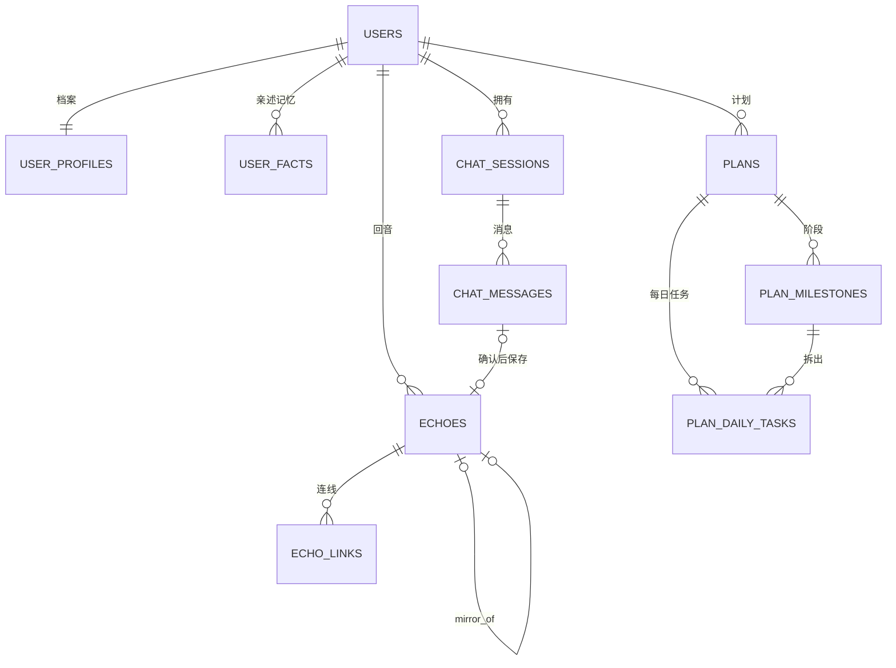

# 02 数据模型说明

> SQLite + SQLAlchemy；时间统一 ISO-8601 UTC 字符串；所有删除均为物理删除。

## 1. 设计要点

- 回音为用户原话，`content` 写入后永不修改；无 AI 摘要、无情绪标签、无积分字段。
- 回音只有两条写入路径：存档询问确认 / 手动指令；拒绝保存不产生任何回音与记忆。
- 删除 = 物理 DELETE，不可恢复；归档 = 仅改 `status`，可恢复。
- 记忆（user_facts）只记用户亲口陈述，可逐条删除。
- 会话按 `space` 隔离上下文，无跨空间引用。

## 2. ER 图

## 3. 表结构

### users 用户

| 字段 | 类型 | 说明 |
|---|---|---|
| id | INTEGER PK | 自增 |
| username | TEXT UNIQUE | 登录名，3-20 位 `[a-zA-Z0-9_]` |
| password_hash | TEXT | bcrypt |
| nickname | TEXT | 默认取 username |
| created_at / updated_at | DATETIME | |

### user_profiles 用户档案（仅亲述信息）

| 字段 | 类型 | 说明 |
|---|---|---|
| id | INTEGER PK | |
| user_id | INTEGER UNIQUE FK | |
| exam_type | TEXT | 备考类型，如"考研" |
| target_desc | TEXT | 目标简述 |
| updated_at | DATETIME | |

> 仅在用户明确说出时写入，AI 不得推断自动填充。

### user_facts 记忆条目

| 字段 | 类型 | 说明 |
|---|---|---|
| id | INTEGER PK | |
| user_id | INTEGER FK | |
| content | TEXT | 亲述的事实性信息 |
| source_message_id | INTEGER FK | 来源消息 |
| told_at | DATETIME | |
| status | TEXT | `active` / `removed`（删除后不进上下文） |

### chat_sessions 会话

| 字段 | 类型 | 说明 |
|---|---|---|
| id | INTEGER PK | |
| user_id | INTEGER FK | |
| space | TEXT | `valley` 回音谷 / `path` 山间小路 |
| title | TEXT | 默认空，可由首条消息截取 |
| status | TEXT | `active` / `closed`（关闭后不可续聊） |
| created_at / last_active_at | DATETIME | |

### chat_messages 消息

| 字段 | 类型 | 说明 |
|---|---|---|
| id | INTEGER PK | |
| session_id / user_id | INTEGER FK | |
| role | TEXT | `user` / `assistant` |
| content | TEXT | 原文 |
| weather | TEXT | 氛围：`mist` / `breeze` / `rain` / `clear`，仅 assistant 消息 |
| save_inquiry | TEXT | `none` / `pending` / `accepted` / `rejected`，仅 user 消息 |
| inquiry_category | TEXT | `emotion` / `reflection` / `reading_touch` / `belief` |
| mode | TEXT | `chat` / `review` |
| created_at | DATETIME | |

### echoes 回音（核心）

| 字段 | 类型 | 说明 |
|---|---|---|
| id | INTEGER PK | |
| user_id / message_id | INTEGER FK | 来源 user 消息 |
| content | TEXT | 用户原话，永不修改 |
| type | TEXT | `normal` / `mirror`（写给自己的回音） |
| mirror_of_id | INTEGER FK | 镜像回音指向对应原回音 |
| source | TEXT | `auto_confirm` / `manual_command` / `mirror_flow` |
| status | TEXT | `active` / `archived`；删除时整行 DELETE |
| created_at / archived_at | DATETIME | |

> 镜像流程成对创建：一条 normal + 一条 mirror（mirror_of_id 指向前者）。

### echo_links 回音连线（P1）

| 字段 | 类型 | 说明 |
|---|---|---|
| id | INTEGER PK | |
| user_id | INTEGER FK | |
| echo_a_id / echo_b_id | INTEGER FK | 应用层保证 a < b 去重 |
| relation_type | TEXT | `resonance` / `growth` / `contrast` |
| created_at | DATETIME | 两端任一回音删除时级联删除 |

### plans 学习计划

| 字段 | 类型 | 说明 |
|---|---|---|
| id | INTEGER PK | |
| user_id | INTEGER FK | |
| final_goal | TEXT | 最终目标 |
| deadline | DATE | 截止日期 |
| daily_hours | REAL | 每日可用时长（0.5–16） |
| focus_minutes | INTEGER | 单次专注时长 |
| rest_buffer_minutes | INTEGER | 默认 15 |
| overpack_sensitivity | TEXT | `low` / `normal` / `high`，影响删减激进程度 |
| weekly_rest_day | INTEGER | 缓冲日 0-6（周一~周日），默认 6 |
| trim_report | TEXT | 超载删减说明（JSON） |
| status | TEXT | `active` / `archived`；同一用户至多一个 active |

### plan_milestones 阶段任务

| 字段 | 类型 | 说明 |
|---|---|---|
| id / plan_id | PK / FK | 级联删除 |
| title | TEXT | 如"3 月：数学一轮" |
| period | TEXT | `year` / `month` / `week` |
| start_date / end_date | DATE | |
| order_index | INTEGER | 沿路顺序 |
| status | TEXT | `todo` / `done` / `adjusted` |

### plan_daily_tasks 每日任务（脚印）

| 字段 | 类型 | 说明 |
|---|---|---|
| id / plan_id | PK / FK | 级联删除 |
| milestone_id | INTEGER FK 可空 | |
| task_date | DATE | 缓冲日不生成任务 |
| content | TEXT | |
| estimated_minutes | INTEGER | ≤ 该日可用时长 |
| status | TEXT | `todo` / `done` / `skipped`，仅用户手动改 |
| completed_at | DATETIME | |

## 4. 隐私要点

- 拒绝存档（`rejected`）：不写 echoes、不写 user_facts、不进复盘候选池。
- 复盘候选池仅取 `status=active` 且 `type=normal` 的回音；镜像回音不自动唤起。
- 删除/清空为物理 DELETE，`echo_links` 级联消失，无回收站。
- 记忆条目 `removed` 后不再拼入对话上下文。
- 演示版不记录 LLM 请求/响应日志。
